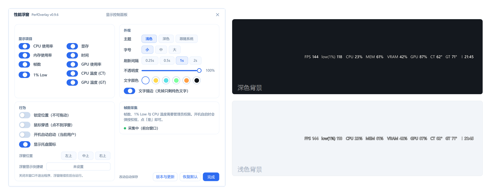
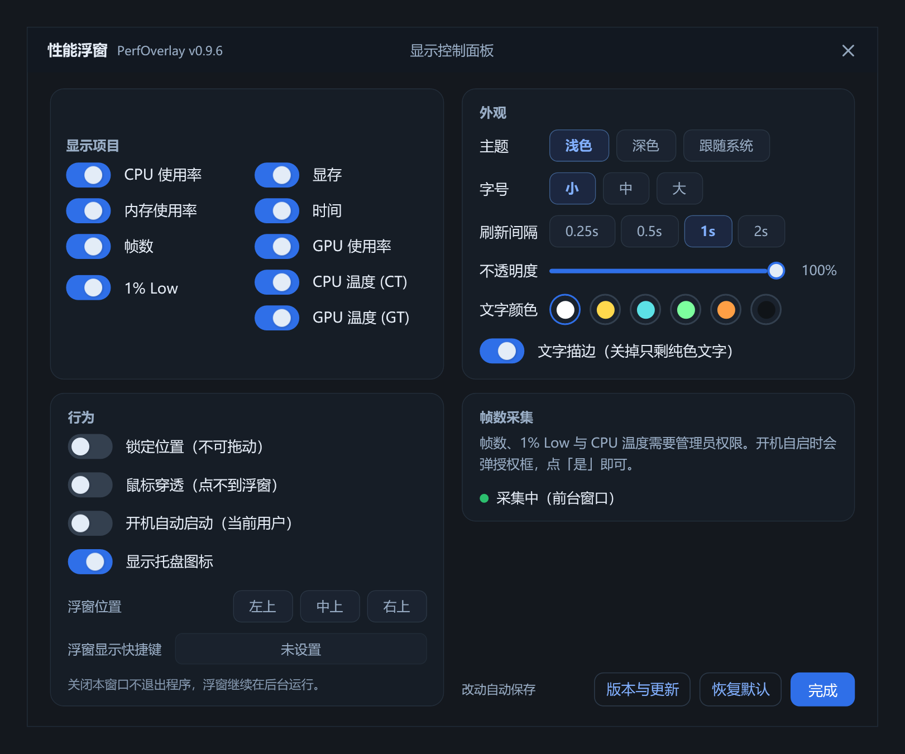

# PerfOverlay · 性能浮窗

一行读数，常驻桌面右上角。透明背景、无边框、不挡操作，CPU / 内存 / 帧数 / 1% Low / 显存 / GPU / CT / GT / 时间想看哪个就开哪个。



> 左：控制面板。右上：深色背景上的浮窗。右下：浅色背景上的浮窗。文字带描边，所以两种底色都读得清。

当前版本 **v0.9.7** · 单文件免安装 · 零第三方运行时依赖 · MIT 许可

---

## 功能

**九项指标**

| 指标 | 默认 | 说明 |
|---|---|---|
| CPU 利用率 | 关 | 整机占用百分比，直接读内核计数器 |
| 内存利用率 | 关 | 整机占用百分比（悬停可看已用 / 总量） |
| 帧数 FPS | **开** | 跟随**前台程序**的呈现帧率，1 秒统计窗 |
| 1% Low | **开** | 最近 10 秒内最慢那 1% 帧的平均帧率，反映卡顿 |
| 显示延迟 | 关 | Present 调用到画面真正出现在屏幕上的毫秒数（中位数），悬停可看 P95 与样本数。**不依赖显卡厂商，NVIDIA / AMD / Intel 通用** |
| 显存利用率 | 关 | 与任务管理器「专用 GPU 内存」同源，按显卡 LUID 匹配 |
| GPU 利用率 | 关 | 整卡利用率，走 WDDM 引擎计数器，与任务管理器同源。**NVIDIA / AMD / Intel 通用** |
| CT | 关 | CPU 温度。装了温度组件就优先读 die 寄存器；没有组件时退回 ACPI 热区。**读数连续 4 分钟不变会被判为死值，自动切到另一条路**。AMD（Zen1~Zen5）与 Intel Core 都可**一键安装**组件（见下） |
| GT | 关 | GPU 温度，走 WDDM 适配器性能数据。**NVIDIA / AMD 通用**，零驱动零权限 |
| 时间 | 关 | 时:分，**固定排在最右**，前面用一条细竖线与指标隔开，不带标签 |

**首次启动只开「帧数 FPS」与「1% Low」两项**，其余全部关闭 —— 浮窗默认就是很短一条。
没勾的项连计数器都不打开，进程里不会多出句柄，取消勾选立刻释放。

**外观**

- **主题：浅色 / 深色 / 跟随系统**，面板、浮窗右键菜单、托盘菜单、气泡提示一起换，点一下即时生效、不用重启
- **托盘图标跟着任务栏配色走**：备了浅色 / 深色两套，系统「Windows 模式」一改就换，不用重启
- 字号三档：小 / 中 / 大
- 文字颜色六种预设：白、黄、青、绿、橙、近黑
- 描边开关：白字压在亮壁纸或文档上也能读；描边色按文字亮度自动取反
- 不透明度 30%–100%
- 刷新间隔 0.25s / 0.5s / 1s / 2s

<p align="center">
  
</p>

**交互**

| 操作 | 效果 |
|---|---|
| 拖动 | 换个位置（会记住） |
| 双击 | 打开控制面板 |
| 右键 | 控制面板 / 隐藏浮窗 / 退出 |
| 托盘图标双击 | 打开控制面板 |
| 托盘图标右键 | 与浮窗右键同一套菜单 |

**行为开关**

- 锁定位置：只能看不能拖
- 鼠标穿透：鼠标直接穿过浮窗点到下面的窗口
- 开机自动启动：写当前用户启动项，不需要管理员
- 显示托盘图标：可完全隐藏到只剩浮窗
- 浮窗复位到右上角：一键贴回原位

---

## 兼容性

| 项目 | 支持范围 |
|---|---|
| 操作系统 | Windows 10 1809 及以上、Windows 11（64 位） |
| 运行时 | .NET Framework 4.8（Win10 1903+ / Win11 系统自带，无需另装） |
| 架构 | x64 |
| 高 DPI | 按 PerMonitorV2 感知；125% / 150% 下贴角与字号一致，不会发虚 |
| 多显示器 | 以**主显示器工作区**定位，自动避开任务栏 |
| 安装 | 免安装，单个 exe，不写系统目录、不装服务 |
| 提权 | CPU / 内存 / 显存**不需要**管理员；只有帧数与 1% Low 需要 |

**关于权限**：帧数依赖 ETW 的 DXGI 事件。程序启动时会请求一次管理员权限：

- 授权 → 五项指标全可用；
- 拒绝 → 继续以普通权限运行，CPU / 内存 / 显存正常，帧数与 1% Low 显示 `N/A`，不会伪造数据。

如果账号已加入本地 **Performance Log Users** 组，则可免提权采集。

---

## 下载与使用

1. 到 [Releases](https://github.com/cjx2022/PerfOverlay/releases/latest) 下载 `PerfOverlay.exe`。
2. 双击运行。首次启动会请求管理员权限（采集帧数用）。
3. 浮窗出现在右上角；双击它或点托盘图标打开控制面板。

程序首次运行会把内嵌的 PresentMon 释放到 `%LOCALAPPDATA%\PerfOverlay\bin\<版本>\`，
配置保存在 `%APPDATA%\PerfOverlay\settings.json`，卸载只需删掉这两处和一个 exe。

**便携用法**：如果程序目录下存在 `tools\PresentMon.exe`，会优先使用那个（方便自行升级采集器），
此时不会往 `%LOCALAPPDATA%` 释放副本。

---

## 指标口径

- **FPS**：最近 1 秒内该程序提交的呈现次数除以实际时间跨度，最少 4 帧才出数。
- **1% Low**：把最近 10 秒的帧时间从大到小排序，取最慢的 1%（至少 1 帧），
  求这些帧的**平均帧时间**，再取倒数。与 CapFrameX / MSI Afterburner 的口径一致。
  少于 100 帧时不出数——样本太少谈 1% 没有意义。
- **显存**：`\GPU Adapter Memory(*)\Dedicated Usage` 中按 LUID 匹配到的那块显卡，与任务管理器一致。
  （DXGI 的 `QueryVideoMemoryInfo` 只统计本进程，不适合做整机读数。）
- 多 swapchain（帧生成、覆盖层）只取最密集的一条，避免同一帧被算两遍。
- Electron / Chromium 系应用（浏览器、Discord、VS Code 等）真正出帧的是 GPU 子进程，
  所以按进程名回落匹配，帧数不会因为是「主进程不提交画面」而变成 N/A。

---

## 已知限制

- **反作弊 / 安全软件**可能拦截 ETW，导致帧数不可用；此时界面上会直说「采集被拦截」，不会编数字。退出该游戏后会自动恢复。
- **显示延迟取的是「出屏延迟」，不是输入延迟**：即 `Present` 调用到这一帧被扫到屏幕上的毫秒数
  （PresentMon 的 `msUntilDisplayed`），取最近 10 秒的中位数，悬停可看 P95 与样本数。
  - 它**不是**「鼠标点击到画面响应」的端到端延迟 —— 那个纯软件测不出来，需要硬件
    （NVIDIA Reflex 鼠标 + 兼容显示器，或光电传感器）。任何声称软件能测端到端延迟的工具都在换算概念。
  - 独立翻转（Independent Flip）、部分覆盖层、Electron 路径上，系统追踪不到显示环节，
    这一列会整段为空；此时浮窗显示 `--`，悬停提示写「这段画面追踪不到显示环节」，
    **不是 0 ms，也不是采集失败**。
  - 取数走 PresentMon 的 ETW 事件，与显卡厂商无关，NVIDIA / AMD / Intel 一视同仁。
- **全屏独占**（Exclusive Fullscreen）模式下 Windows 不合成桌面，浮窗不可见。改用无边框窗口（Borderless）即可。
- 前台程序不提交画面时（暂停、最小化、静态桌面）帧数显示 `N/A`，这是预期行为。
- 多显卡机器取**物理显存最大**的那块，不做逐卡切换。
- 目前只定位主显示器，多屏拓展场景下浮窗不会跑到副屏。
- **CT（CPU 温度）分两级，驱动优先、ACPI 兜底**：
  1. **装了温度组件就优先走寄存器**（AMD 读 SMN `0x00059800`，Intel 读 MSR `0x1A2`/`0x1B1`）。
     这是写在 die 里的传感器，也是任务管理器类工具对齐的那个数。
  2. 组件不可用时，退回固件 ACPI 热区（`root\WMI`），零驱动零权限。笔记本通常有；
     台式 DIY 主板常常不实现 `_TZ`，实测会直接返回「不支持」。

     注意 ACPI 热区是**固件转述**的数，有些主板给的是恒定占位值，看起来像「温度一动不动」。
     判断办法：设置了组件却仍是同一个数，先看悬停提示里写的取数来源；装了组件时一定会走第 1 条。

  **恒定读数会被当成异常处理**：同一路连续 4 分钟一字不差、而另一路确实会变（历史读数里出现过
  不止一个值），就把不动的那一路降级、改用另一路；切换后保持 60 秒再评估，避免来回跳。
  两路都不动时留在驱动 —— 真 die 传感器即使空闲也不该比固件占位值更可疑。
  只有 ACPI 能读且读数不动时，CT 旁边会出现感叹号：那不是「没装驱动」，而是「现在这个数是假的」。

  需要组件时，设置面板「CPU 温度 (CT)」旁边会出现一个**小感叹号**。点开看清说明、
  按「下载并安装」，程序会下载官方 [PawnIO](https://github.com/namazso/PawnIO) 安装器
  （约 3.3 MB）、校验数字签名、以管理员身份静默安装，然后改读寄存器：
     - **AMD Zen1~Zen5**（family 17h~1Ah）：SMN 寄存器 `0x00059800`
     - **Intel Core**（family 6）：MSR `0x1A2`（TjMax）与 `0x1B1`（当前偏移）

     装完约 1 MB，可在「应用和功能」里正常卸载。**不做这一步也不影响任何其它指标**，
     CT 显示 `--` 而已。程序自己绝不会偷偷装东西：读不到时它只是把状态记下来、
     显示感叹号，装与不装完全由你决定。
     *Intel 路径与 AMD 共用同一套 PawnIO 桥接与安装引导，但尚未在 Intel 真机验证过；
     读数带 TjMax 与合理区间双重闸门，读不到就显示 `--`，不会给出错误数字。*

- **读 CT 需要以管理员身份运行**：PawnIO 的设备对象在 INF 里写死了
  `D:P(A;;GA;;;SY)(A;;GA;;;BA)` —— 只授权 SYSTEM 与 Administrators，这是驱动的安全模型，不是缺陷。
  程序启动时本来就会自动提权一次；被拒绝时 CT 显示 `--`，设置面板的感叹号会提示「以管理员身份重启」。
- **装过又卸载过也能直接重装**：官方卸载器会删掉设备实例与 `.sys`，却把服务键和 DriverStore 里的
  驱动包留着。这种状态下再点「下载并安装」，安装器会因为「驱动包已导入」而跳过导入、直接装设备，
  然后在 `AddService` 上以 `0x2 系统找不到指定的文件` 静默失败 —— 用户的观感正是
  「点一下立刻说没装上」。0.9.5 起装之前会自动识别这种残留：删服务键 →
  `pnputil /delete-driver` 删包 → 再走一遍全新安装；判定「装没装」也改成看 PnP 设备实例
  （`ROOT\PAWNIO\0000`），不再被残留的服务键误导成「缺管理员权限」。
- **GT（GPU 温度）取决于驱动**：走 WDDM 适配器性能数据，主流 NVIDIA / AMD 驱动都提供；
  虚拟机、远程桌面、部分核显没有温度传感器时显示 `--`。

---

## 开源组件

| 组件 | 版本 | 许可 | 用途 |
|---|---|---|---|
| [PresentMon](https://github.com/GameTechDev/PresentMon) | 2.6.0 | MIT（Intel Corporation） | 读取 GPU 呈现事件，计算帧数与 1% Low |
| [PawnIO 模块 AMDFamily17](https://github.com/namazso/PawnIO.Modules) | 0.2.11 | LGPL-2.1 | 读 AMD SMN 寄存器取 CPU 温度（可选，需用户自行安装驱动） |
| [PawnIO 模块 IntelMSR](https://github.com/namazso/PawnIO.Modules) | 0.2.11 | LGPL-2.1 | 读 Intel MSR 温度寄存器取 CPU 温度（可选，同上） |

PresentMon 与两个 PawnIO 模块都以嵌入资源的形式打包进 exe，属于再分发，
其版权与许可全文见 [THIRD-PARTY-NOTICES.md](THIRD-PARTY-NOTICES.md)。
PawnIO 驱动本体**不由本项目分发**，只在你点了「下载并安装」后从官方地址获取。

除上述组件外，程序只用到 .NET Framework 自带的 WPF / Windows Forms / System.Drawing，
无任何第三方 NuGet 运行时依赖。

---

## 许可

[MIT](LICENSE) © 2026 BillChen

## 更新日志

**v0.9.7**（2026-11-12）

- **换新图标**：屏幕 + 上行折线两版设计，exe 图标与托盘图标一起换。
- **托盘图标跟着任务栏配色走**：备了浅色 / 深色两套，跟着系统「Windows 模式」
  （`SystemUsesLightTheme`）换，不是面板用的「应用模式」—— 两者可以分别设置，
  读错就会出现「任务栏已经深色、图标还是浅色版」。在系统里改一下立刻生效，不用重启。
- **新增显示延迟**：`Present` 调用到画面真正出现在屏幕上的毫秒数，取最近 10 秒的中位数，
  悬停可看 P95 与样本数。**默认关闭**，想看的自己勾。
- 取数走 PresentMon 的 ETW 事件，**不依赖显卡厂商，NVIDIA / AMD / Intel 通用**；
  独立翻转、部分覆盖层、Electron 路径追不到显示环节时显示 `--` 并写明原因。

> 注意事项
> - 这是**出屏延迟**，不是输入延迟。端到端延迟（点到屏幕亮）纯软件测不出来，别拿它对 Reflex 的数。
> - 延迟与帧数共用同一条采集链路：帧数 N/A 的时候，延迟也拿不到。

**v0.9.6**（2026-11-11）

- **新增深色主题**：设置 → 外观 → 主题，浅色 / 深色 / 跟随系统，各带一枚配色缩略图。
  跟随系统读 Windows「应用模式」，不跟任务栏配色。面板、右键菜单、托盘菜单、气泡一起换色，
  即点即生效，不用重启。
- **两套配色都做了对比度核算**：正文全部达到 WCAG AA，11px 小字最低 4.4:1。
- **修复「装了温度组件，温度却一直不动」**：组件可用就一律优先读 die 内传感器，
  不可用才退回 ACPI 热区。
- **读数恒定被当成异常处理**：一路连续 4 分钟不变、而另一路确实在变时，自动改用会变的那一路，
  切换后保持 60 秒再评估，避免来回跳；两路都不变则留在组件读数。
- **温度状态提示更准**：感叹号只在真的读不出温度时出现，悬停提示标明当前取数来源。
- **帧数采集链路加固**：处理了缓冲背压、PresentMon 异常退出与会话占用，
  长时间运行后间歇 `N/A` 应明显减少；采集掉线自动重建会话，不用重启程序。

> 注意事项
> - 主题偏好存在 `settings.json` 的 `Theme` 字段（`light` / `dark` / `auto`），老配置升级后仍是浅色。
> - 深色只作用于本程序自绘的界面，系统级弹窗仍用系统配色。
> - 恒值切换是启发式：机器极度空闲、温度长期稳定在同一格时也可能触发一次；
>   要看寄存器原文跑 `--pawnio-status`。
> - 帧数只统计**前台窗口提交的画面**，暂停 / 最小化 / 静态桌面时显示 `N/A`，不是采集失败。

**v0.9.5**（2026-11-07）

- **GPU 利用率改为全平台通用**：数据源换成 WDDM 的 `\GPU Engine` 计数器（任务管理器同源，
  取「最忙引擎」），AMD / Intel 显卡不再显示 N/A。原来只走 NVIDIA 的 NVML，A 卡必然读不到。
- **GPU 温度改为全平台通用**：走 WDDM 适配器性能数据（`KMTQAITYPE_ADAPTERPERFDATA`），
  AMD 显卡同样可读，且**不需要管理员权限、不需要任何驱动**。
- **CT 与 GT 拆成两个独立开关**：原来是合在一起的「温度 CT/GT」，现在想看哪个开哪个，
  浮窗上也各占一格。旧配置里开着的温度会自动带到两项，升级不会丢。
- **CPU 温度分两级，AMD 与 Intel 都覆盖，且驱动优先**：装了温度组件就直接读寄存器
  （AMD SMN `0x00059800`、Intel MSR `0x1A2`/`0x1B1`）；没有组件时退回 ACPI 热区
  （零依赖、免管理员、不加载驱动，因此不会被内存完整性 HVCI 拦截）。
  需要组件时设置面板「CPU 温度 (CT)」旁出现小感叹号，
  点开可一键安装官方 [PawnIO](https://github.com/namazso/PawnIO)（微软签名、HVCI 兼容、
  不在易受攻击驱动阻止列表）。
- **安装全程可见**：下载 → 校验 PE 头、体积与签名者（必须是 namazso）→ UAC → 静默安装 →
  打开设备实测。任一步失败都如实显示原因，不重试、不换源。**不装不影响其它任何指标**。
- **温度读不到时显示 `--`**（原为 `N/A`），与安装引导里的文案一致。
- 读 CT 需要以管理员身份运行（PawnIO 设备的 ACL 只授权 SYSTEM 与 Administrators），
  复用程序已有的提权链路，没有新增常驻进程、没有计划任务。
- 新增 `--pawnio-status`（只读诊断）与 `--pawnio-install`（命令行安装）两个参数。
- **彻底移除第三方运行时依赖**：不再内置硬件监控库与内核驱动，发布物仍是单个 exe，
  **体积从 2.29 MB 降到约 1.2 MB**，附带的 dll 数为 0。
- NVML 降为兜底路径：只有上面两条 WDDM 路径都失败时才加载 `nvml.dll`（N 卡驱动自带）。

**v0.9.4**（2026-11-07）

- 新增：GPU 利用率（整卡），走 NVIDIA 驱动自带的 NVML，与 nvidia-smi 同源。
- 新增：CT / GT 两项温度 —— CT 读 CPU 的 DTS（AMD 认 Tctl/Tdie，Intel 认 CPU Package），GT 读显卡核心。
- 新增：时间显示（时:分），固定最右、竖线分隔、不带标签。
- 新增的四项默认关闭；关闭时 NVML、监控 dll、内核驱动都不加载，勾上才按需打开。
- 控制面板「显示项目」改为两列排布。
- 修复：数值刷新时浮窗会在项与项之间留下小方块、斜线等残影（分层窗口脏区漏算）。
- 设置面板标题栏与托盘提示改为带版本号。
- 新增：切换显示项开关后浮窗自动复位到当前设置的角点；此前若拖动到过自定义位置，会自动复位到右上角。
- 发布物仍是单个 exe（硬件监控的三个 dll 内嵌，运行时按需加载）。

**v0.9.3**（2026-11-05）

- 新增：显示 / 隐藏浮窗的全局热键（设置 → 行为）。录入时直接向系统注册，组合键已被其他程序占用会当场提示。
- 新增：浮窗位置可一键切到左上 / 中上 / 右上（设置 → 行为）。
- 修复：上次退出时浮窗是隐藏状态，再次启动后内存不再回收，占用会一路涨到 100 MB 上下。
- 优化：浮窗隐藏期间不再刷新界面，后台占用稳定在 10 MB 以内。

**v0.9.2**（2026-11-05）

- 修复：帧数偶发永久显示 N/A，重启程序无效、只能重启系统才恢复。
- 修复：帧数采集重启后可能一直起不来。

**v0.9.1**（2026-11-01）

- 新增：浮窗隐藏后自动回收内存，重新显示时恢复正常。任务管理器里那一列从约 86 MB 降到 12–15 MB。
- 新增：`--mem` 内存占用明细开关、`--sw` 软件渲染开关。正常使用不需要。

**v0.9.0**（2026-10-31）

- 首个公开版本。

## 从源码构建

```bash
dotnet build -c Release
```

产物为 `bin/Release/net48/PerfOverlay.exe` 单个文件，PresentMon 已在编译时嵌入。
